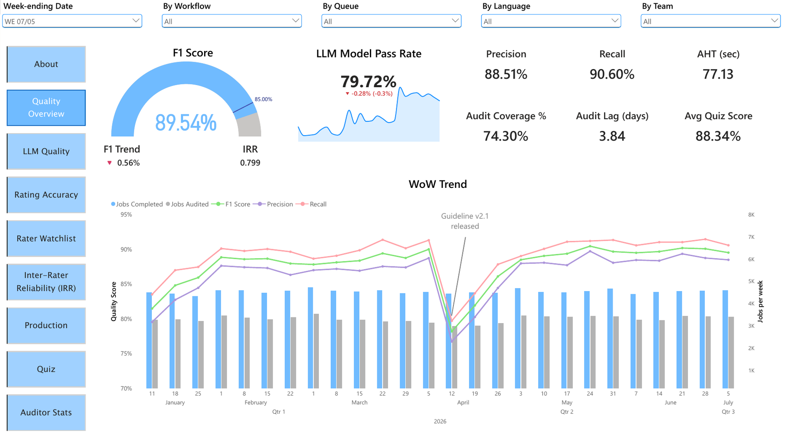

# LLM Evaluation Programme KPI Dashboard

Model quality, rater accuracy, agreement and audit throughput across an 80-rater evaluation programme.

Built in Power BI from eight years running AI Ops and human data operations: LLM evaluation, rubric design and annotator QA.

**[Live dashboard](LIVE_LINK_HERE)** · **[PDF export](LLM%20Evaluation%20KPI%20Dashboard.pdf)** · **[.pbix file](LLM%20Evaluation%20KPI%20Dashboard.pbix)**



## What it measures

Eight pages answering the questions a quality lead actually opens a dashboard to answer:

| Page | Question |
|---|---|
| Quality Overview | Where is the programme this week, and what moved |
| LLM Quality | How good are the model responses, and what is wrong with them |
| Rating Accuracy | Where are raters wrong, by label and by language |
| Rater Watchlist | Which raters need attention, and why |
| Inter-Rater Reliability | Do two raters given the same item agree, and does that agreement mean anything |
| Production | How much work got done, at what pace, and how much produced nothing |
| Quiz | Does quiz performance predict rating quality |
| Auditor Stats | Is the audit function keeping up, and are auditors calibrated with each other |

## Data model

Star schema, four fact tables and six dimensions.

**Facts**

- `Fact_Production` — 123,000 rated jobs, one row per job
- `Fact_Audit` — 483,000 rows, one per job per label
- `Fact_IRR` — 40,000 double-rated items, one row per pair per label
- `Fact_Quiz` — 1,956 weekly quiz attempts

**Dimensions** — Rater, Auditor, Queue, Label, Model, Date

Two design decisions worth noting.

**Ragged grain.** `item_rejected` is scored on every audited job. The five content labels are only scored on mutually ratable items, meaning neither the rater nor the auditor rejected them. Scoring content labels on rejected items would have invented true negatives and inflated accuracy.

**Date anchoring.** Every page is anchored on `rating_date` rather than `audit_date`, so quality metrics and their denominators cover the same population. Audit lag averages 4.2 days, so anchoring on audit date would smear each week's quality across two or three rating weeks.

## Key measures

Confusion matrix, from which precision, recall, F1 and accuracy are derived:

```dax
TP = CALCULATE([Audited Decisions], Fact_Audit[rater_value] = 1, Fact_Audit[audit_value] = 1)
FP = CALCULATE([Audited Decisions], Fact_Audit[rater_value] = 1, Fact_Audit[audit_value] = 0)
FN = CALCULATE([Audited Decisions], Fact_Audit[rater_value] = 0, Fact_Audit[audit_value] = 1)
```

Cohen's Kappa, chance-corrected agreement:

```dax
Cohens Kappa = DIVIDE([Raw Agreement] - [Pe Expected Agreement], 1 - [Pe Expected Agreement])
```

Raw agreement runs at 0.94 while Kappa sits at 0.80. The dashboard shows both, because raw agreement is inflated by labels where both raters say "no" most of the time, and Kappa is what tells you whether the agreement means anything.

Over-rejection detection, which combines rate with correctness:

```dax
Over-Rejection Flag =
VAR RaterRate = [Reject Rate]
VAR TeamRate  = CALCULATE([Reject Rate], REMOVEFILTERS(Dim_Rater))
VAR RaterPrec = [Reject Precision]
RETURN
    SWITCH(TRUE(),
        ISBLANK(RaterRate),                            BLANK(),
        RaterRate > TeamRate * 1.5 && RaterPrec < 0.6, "Review - likely over-rejecting",
        RaterRate > TeamRate * 1.5,                    "High reject rate",
        RaterPrec < 0.6,                               "Low reject precision",
        "Normal")
```

Rate alone is not evidence. A rater working a genuinely poor queue will legitimately reject more. It is high rate combined with low precision that identifies someone rejecting items they should have rated.

## What the data shows

**A guideline change in week 14 degraded four independent measures at once.**

| Measure | Before | Week 14 | Recovery |
|---|---|---|---|
| Cohen's Kappa | 0.755 | 0.539 | 3 weeks |
| Quiz pass rate | 78.7% | 34.2% | 3 weeks |
| Disagreement rate | 4.7% | 8.3% | 3 weeks |
| Audit lag | 3.5 days | 8.9 days (peaking two weeks later) | 4 weeks |

Quiz pass rate fell four times as far as average quiz score, which means raters were clustered just above the 80% threshold rather than comfortably above it.

**Over-rejection is concentrated in one team, not one language.**

Arabic raters reject at 11.4% against an auditor-confirmed rate of 5.81%, the lowest of any language. Four of the eight flagged raters are Arabic and all four sit on the same team. The language looked like the problem until the team column was added.

**Quiz performance predicts rating quality.** Correlation of +0.64 between average quiz score and F1. Raters scoring under 75 average 79.0% F1, those scoring 85 or above average 90.3%.

**Model releases show a measurable trade-off.**

| Release | Pass rate | Factual error | Tone issue |
|---|---|---|---|
| v2.0 | 74.15% | 8.92% | 7.23% |
| v2.1 | 76.51% | 6.35% | 9.43% |
| v2.2 | 80.80% | 5.37% | 8.66% |

The v2.1 factuality tune cut factual errors by 29% and raised tone issues by 30%. Pass rate still improved, so the trade was worth making, but it would have been invisible without per-label tracking.

## Repo contents

```
README.md
LLM Evaluation KPI Dashboard.pdf     full report, nine pages
LLM Evaluation KPI Dashboard.pbix    Power BI file
screenshots/                         one PNG per page
```

The .pbix carries its data cached in the model, so it opens and works without the source files. Every page, measure and relationship is there to inspect. Refreshing is the only thing it will not do, since the source CSVs are not published.

## A note on the data

The data is synthetic, generated for this portfolio piece. No client or production data is used, and no real rater, auditor or queue is represented.

It was built to behave like a real programme rather than to look tidy: rater skill varies, a handful of raters game the workflow by over-rejecting, audit lag responds to backlog pressure, and a guideline change in week 14 degrades quality before the team recovers. The findings above are consequences of that design, not coincidences in random numbers.

---

Bhavna S. · [LinkedIn](LINKEDIN_LINK_HERE) · [GitHub](https://github.com/buzzz001)
